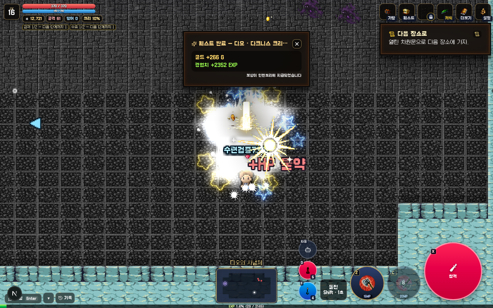

# 초반 디오전·입력·세이브·로딩 회귀 검사

기준: `434dab1`, v2.2.27 / vc285 유지. Chromium, 로컬 Next 개발 서버(3100), 소프트웨어 WebGL. 운영 재배포 후 실측 결과가 아니다. 프로덕션/APK/EXE 빌드는 실행하지 않았다.

## 첫 디오전

- 본편 `lilacworld2x3`에만 체력 19,800 → 3,600, 공격력 24, 방어력 8 / 비율 5%, 이동속도 82를 적용했다. 재도전·GM·공동토벌의 별도 능력치 계산은 유지한다.
- 돌진은 1,200ms 동안 바닥 진행선을 보여 주고, 예고 시작 위치로 방향을 고정한다. 출발 직전 플레이어를 다시 조준하지 않는다. 돌진속도 360, 공격 후 반격 시간 2초, 동시 생존 권속 상한 2마리다.
- 새 게스트 생성부터 첫 컷씬·튜토리얼을 거쳐 디오 처치까지 실제 키보드/UI 조작으로 통과했다. GM, 튜토리얼 스킵, 진행도·능력치·적 체력·타이머 변경을 사용하지 않았다. 좌표와 상태를 읽어 입력을 고르는 자동 조작이며 사람의 재미 평가를 대체하지 않는다.
- 처치 후 Lv16, 시작 검·갑옷(`weapon_1`, `armor_1`), 미사용 AP 75, HP 370/370, HP 물약 5개 / MP 물약 4개, 처치 목표 완료와 다음 목표 활성화를 확인했다. 처치 직후 체력에는 레벨업 회복이 포함될 수 있으므로 전투 중 무피격의 근거로 삼지 않는다. 페이지 예외 0건.



## 첫 컷씬과 선택지

Space, Tab, ESC, Space를 누른 채 포인터 선택, Space 해제 후 방향키·Space 선택, 모바일 터치, 캐릭터 생성 직후 새로고침, 컷씬 도중 새로고침의 8개 독립 캐릭터 검사가 통과했다. 각 검사에서 이동 튜토리얼 진입, 대화·시네마·물리 정지 해제, 활성 캐릭터와 저장 이름 일치, 페이지 예외 0건을 확인했다. ESC는 정상 건너뛰기이며 선택지 응답을 저장했다고 간주하지 않는다.

선택지 직후 250ms 보호가 새 포인터 클릭까지 버리는 문제를 수정했다. 키보드는 누르고 있던 확인 키를 계속 차단하고, 해제 후 새 입력으로 확정한다. 기존 운영 첫 Space 크래시의 원인은 여전히 특정되지 않았다. 이 반복 검사 성공을 간헐 크래시의 완전 해결로 표현하지 않는다.

## 표식 없는 v3 세이브 복구

기존 구조임을 식별할 수 있는 인덱스는 자동 이관한다. 이미 새 목표 대화를 본 세이브는 보존한다. 완료 인덱스 1이고 대화 표식이 없어 구분할 수 없는 세이브는 완료 상태를 유지하면서 퀘스트 창에 사용자가 선택할 수 있는 목표 재열기 기능을 제공한다. 새 이관 revision은 2다.

스타게이트 2구역의 모호한 v3 저장 픽스처로 실제 UI 검사를 했다. 목표 재열기 → 인덱스 1에서 0 → NPC까지 이동·대화 → 완료 인덱스 1 → 새로고침 복원을 통과했다. 골드 17,345, 경험치 3,456은 재열기·완료·복원 전후 동일했다. 원본 문자열은 전용 `quest-layout` 백업에 그대로 남았고, 완료 후 복구 표시와 보상 차감 기록이 소모됐다. 페이지 예외 0건.

모호한 기록을 완벽하게 추론하는 기능은 아니다. 복구를 선택하면 해당 목표를 다시 진행하고 추가 보상은 지급하지 않는 보수적 정책이다. 레벨·장비·재화·다른 구역 진행도는 유지한다. 실제 사용자 계정 대신 통제된 픽스처로 검증했다.

## 초기 로딩

캐시 비활성, 지연 40ms, 다운로드 초당 2,500,000바이트 조건. 캐릭터 시작 클릭부터 `assetsReady`까지 측정했다. 요청 수·바이트는 같은 페이지의 `/assets/` 리소스 기록 전체이며 타이틀 로딩도 포함한다.

| 항목 | 변경 전 | 최종 변경 후 |
| --- | ---: | ---: |
| 시작 클릭 → 월드 준비 | 30.895초 | 22.523초 |
| 월드 로딩 단계 시간 | 29.838초 | 21.147초 |
| 논리적 로딩 항목 | 1,317 | 1,204 |
| 실제 에셋 요청 | 1,386 | 206 |
| 에셋 전송량 | 54,759,636바이트 | 25,621,893바이트 |

별도 최종 검사에서는 21.849초였다. **10초 목표는 미달**이며 단일 개발 환경 측정으로 운영 속도를 보장하지 않는다. 최종 측정에서도 컷씬 종료와 이동 튜토리얼, 페이지 예외 0건을 확인했다.

기존 그림 178개를 보이는 RGBA가 동일한 무손실 WebP로 준비하고, 첫 구역 공통 그림 1,036개를 같은 바이트의 gzip 묶음으로 제공한다. 원본은 삭제하지 않는다. 패키지 압축 해제 크기는 약 17.2MB이며 생성 시 20MiB 상한을 검사한다. 미지원 브라우저·실패 시 개별 파일로 돌아가는 처리는 실행 가능한 단위 검사로 확인했다.

첫 장은 실제 등장 배우만 준비하고 다른 구역은 기존 로딩 관문에서 준비한다. 효과는 기존 허용 목록 안에서 필요 시 받는다. 직업 스킬이 동기적으로 사용하는 9개 효과 시트는 선행 로딩을 유지한다. 일반 타격·처치·획득 효과 크기와 기존 동시 재생 제한을 유지·축소한다. 신규 그림 생성이나 외부 제작 서비스는 사용하지 않았다. 출처와 해시는 `public/assets/CREDITS.md` 및 두 manifest에 기록했다.

## 실행과 남은 범위

전체 860개 테스트, `tsc --noEmit`, 변경 코드 ESLint 통과. 실제 독립 편집기 JSON 왕복 검사는 [별도 기록](independent-editors.md)에 있다. MQTT 구버전 상호 운용, 일반 몬스터 공격 프레임 확대·개체별 외형, 모든 보스 피격 범위, 전체 본편 일반 플레이 완주는 이번 수정으로 검증됐다고 간주하지 않는다. 로컬 계정/채팅 서버 연결 설정 부재도 유지된다.

```sh
CHROMIUM_PATH=/usr/bin/chromium node scripts/playtest-opening-regression.mjs
CHROMIUM_PATH=/usr/bin/chromium node scripts/playtest-quest-recovery.mjs
CHROMIUM_PATH=/usr/bin/chromium node scripts/measure-opening-loading.mjs
CHROMIUM_PATH=/usr/bin/chromium TUTORIAL_QA_OUT=/dev/shm/certz-natural node scripts/playtest-tutorial.mjs
CHROMIUM_PATH=/usr/bin/chromium PROGRESSION_QA_URL=http://127.0.0.1:3100 PROGRESSION_QA_OUT=/dev/shm/certz-natural node scripts/playtest-live-progression.mjs
```

리소스 원본 기록은 로컬 `scratch/review-baseline`, `review-loading-quiet`, 입력은 `review-opening-final`, 복구는 `review-recovery-final`, 일반 진행은 `review-natural`에 남겼다. 이 기록은 테스트 캐릭터 데이터이며 운영 세이브를 수정하지 않았다.
