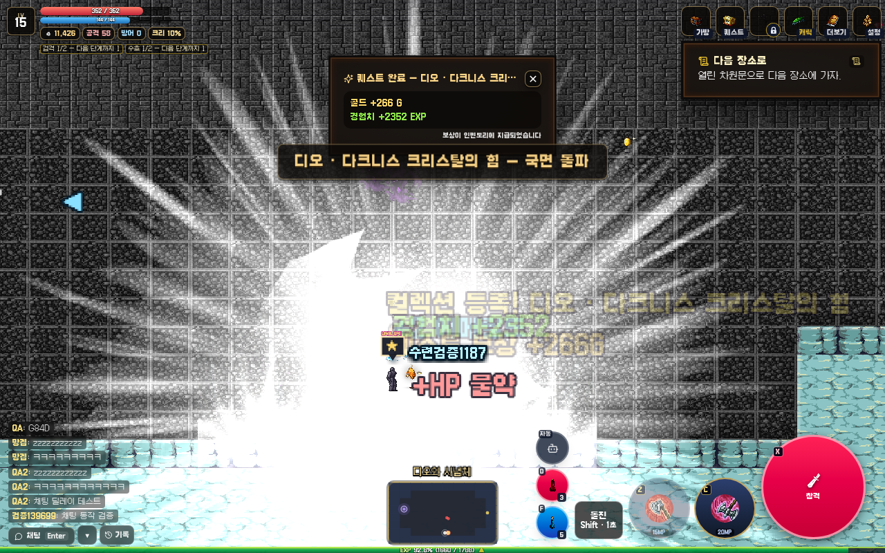
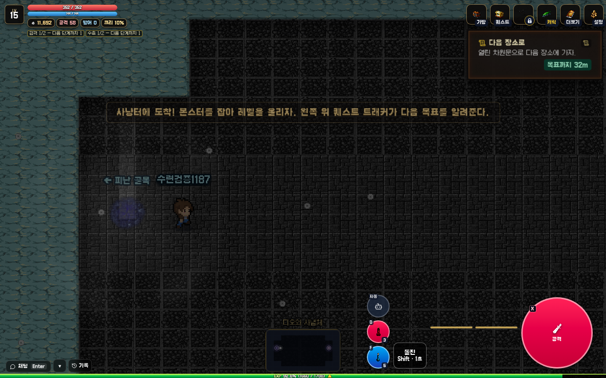
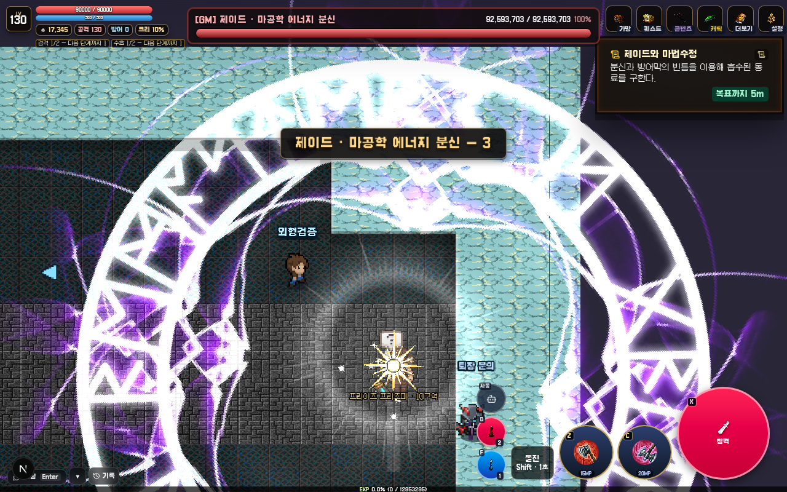
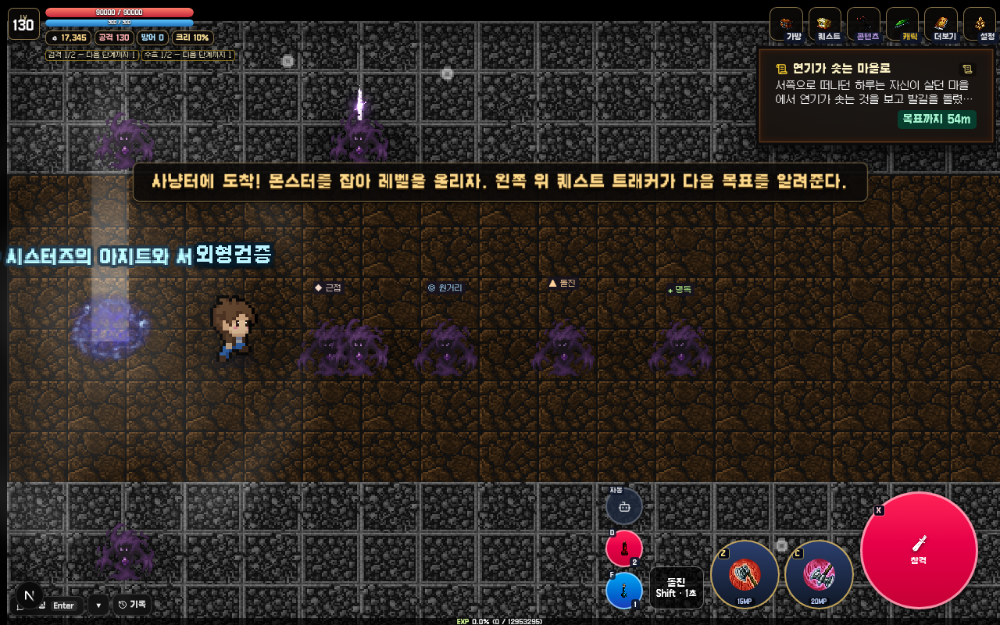

# 운영 초반 완주와 첫 연출·메모리·전투 식별성

목표는 평가 점수 자체를 선언하는 것이 아니라 실제 배포에서 진행·저장과 연출을 확인하는 것이다. v2.2.27 / vc285 유지, 프로덕션/APK/EXE 빌드 수동 실행 없음. 기준 SHA는 `56e52e24e600609be38eb0aa0ec848a75676064a`다.

## 실제 운영 사이트: 새 게스트 → 디오 → 저장·재접속

`https://sertz.vercel.app/api/version`에서 기준 SHA 일치를 확인한 뒤, 새 브라우저 저장소의 게스트를 UI로 생성했다. 튜토리얼 중 실제 새로고침을 포함해 83.053초, 이어서 디오 처치까지 127.281초가 걸렸다. 이동·공격·스킬·물약·돌진·대화는 정상 키보드/UI로 입력했다. GM, 튜토리얼 스킵, 능력치·적 HP·진행도·타이머 변경은 사용하지 않았다. 위치와 상태를 읽어 입력을 선택하는 자동 조작이며 사람의 재미 검사가 아니다.

처치 후 Lv15 / 시작 검·갑옷 / 미사용 AP 70 / HP 352/352 / HP 물약 2개 / MP 물약 5개였다. 완료 인덱스 1과 다음 목표를 확인했다. HP 물약을 소비한 결과이므로 무피격이나 과도하게 쉬운 전투의 증거로 해석하지 않는다. 레벨업 회복도 있으므로 처치 직후 HP로 피격량을 추정하지 않는다. 이번 작업에서 디오 수치를 다시 바꾸지는 않았다.

그 실제 저장소를 새 세션으로 열고 다시 새로고침했다. 두 번 모두 디오 완료 상태, Lv15, AP 70, 골드 11,692, 시작 장비와 활성 캐릭터가 보존됐고 보스는 재생성되지 않았다. 컷씬·튜토리얼·일반 진행·재접속의 페이지 예외는 각각 0건이다. [구조화한 운영 결과](production-baseline.json).





## 첫 보스 효과의 누락과 수명

두 코드 경로를 함께 고쳤다. 일부 보스 이벤트는 로딩 허용 목록에 없는 시트만 가리켰고, 직업 궁극기 정리가 공용 `sunburst` 등 시작 효과까지 내려 버렸다. 이 상태에서는 첫 호출이 다운로드만 걸고 끝날 수 있었다.

- 보스 이벤트를 기존 허용된 효과에 연결하고, 각 이벤트에 준비된 공용 대체 효과를 둔다.
- 보스 구역·GM/재도전 로딩 관문에서 전용 효과 8종을 준비한다.
- 직업 변경 시 이전 직업 전용 효과를 회수하되 공용 시작·직업 스킬 그림은 유지한다. 직업별 추가 다운로드는 여전히 해당 직업의 4종만 요청한다.
- 첫 호출을 0ms 시각으로 오인해 차단하던 스로틀 초기값을 수정한다. 일반 효과의 크기 44px 및 기존 동시 재생 제한은 유지한다.
- 게임 인스턴스를 다시 만들었을 때 이전 메타데이터만 보고 등록을 생략하지 않도록, 현재 게임의 애니메이션 존재도 함께 확인한다. 이 조건은 수정 전 실패/수정 후 통과하는 실행 검사로 확인했다.
- 이 관리자의 반복 시트는 한 번 재생하고 완료 시 회수한다. 궁극기의 별도 지속 연출은 기존 수명 관리를 유지한다.

제이드·클로체스·베로니카/딘·사념체의 통제된 로컬 브라우저 검사에서 8종 보스 이벤트의 첫 호출로 실제 스프라이트가 만들어지는 것을 확인했다. 자연 진행 검증과 별도로 고레벨 픽스처·전환·소환을 사용한 연출 검사다.

각 보스에서 첫 등장 효과를 실제 화면 프레임까지 유지해 활성·가시 상태와 텍스처를 확인하고 캡처했다. [구조화한 연출 결과](visual-results.json).



## 패키지 분리와 초기 로딩

기존 그림 1,047개를 필수 그림과 효과로 나누어 11개 패키지로 준비했다. 압축 해제 크기는 패키지당 최대 2,096,032바이트(2MiB 이하)다. 현재 로딩 관문에서 요청한 패키지만 받는다. 한 패키지에서 필요한 이미지의 복사를 마치면 즉시 버퍼를 비우고, 관문 종료·실패·게임 종료 때도 해제한다. 각 다운로드는 6초 상한과 중단 신호를 갖고 실패 시 개별 파일을 사용한다. 원본 그림과 v1 패키지도 남겼다.

같은 캐시 없는 개발 서버·지연 40ms·다운로드 2.5MB/s 조건에서 시작 클릭→월드 준비는 22.523초에서 **14.240초**로 감소했다. 논리 항목 1,204개, 기록한 `/assets/` 요청 204개, 전송 25,622,597바이트다. 전송량 추가 절감보다 큰 패키지의 대기·디코드 집중을 줄인 결과다. 로딩 완료 시 패키지 보관량은 0바이트였다. 같은 실행에서 첫 컷씬 종료와 이동 튜토리얼까지 확인했다.

**10초 목표는 아직 미달**이다. 개발 화면 측정을 운영 속도나 실기기 성능으로 표현하지 않는다. Chromium 모바일 뷰포트 모의 검사에서는 13.122초, 패키지 보관 0바이트, 측정 중 JS 힙 최대 40,857,144바이트 / backing storage 최대 69,986,027바이트였다. 진단용 GC 후에는 각각 36,886,532바이트 / 29,274,250바이트였다. 이는 GPU·전체 프로세스 메모리와 다르며, 물리 휴대폰 검사나 메모리 회귀 부재의 증거는 아니다.

모든 패키지 네트워크 요청을 실패시키는 브라우저 검사에서도 개별 파일로 전환해 월드 준비·컷씬 종료·이동 튜토리얼까지 통과했다. 이 실행은 전체 단위 검사와 함께 진행했으므로 지연 비교에 사용하지 않는다. 6초 다운로드 중단과 패키지별 버퍼 회수는 별도 실행 검사로 확인했다. [구조화한 로딩·메모리·실패 경로 결과](loading-results.json).

## 적 동작과 식별성

동일 진영 외형을 공유하는 적에 근접 `◆`, 원거리 `◎`, 돌진 `▲`, 맹독 `✚` 표식과 실제 공격 방식에 맞는 이름을 붙였다. 색 외에 모양·문자로도 구분한다. 접근/교전 시 나타나며 피격이나 공격 예고가 표시를 지우지 않는다. 카메라 축소를 보정해 글자가 지나치게 작아지지 않도록 하며, 개체 종료 시 표식도 회수한다. 적 ID·능력치·드롭·퀘스트 집계와 기존 판정 크기는 유지한다.

기존 8개 그림을 재사용해 준비 동작 3단계와 타격·복귀 4단계를 연결했다. 준비 동작의 속도는 실제 AI 예고 시간에 맞추고, 공격은 반복하지 않는다. 전체에는 서로 다른 기존 6포즈가 쓰인다. 새 공격 원화를 6장 그린 것은 아니며, 직접 타격 그림 자체는 기존 2장이다. 같은 진영 내 새 실루엣 제작도 아직 남아 있다.

사념체·도깨비·선원·감염체·제이드 분신·드론/로봇의 6개 구역에서 적용을 확인했다. 네 가지 유형을 같은 장소에 만든 통제 검사에서 표식·이름 차이, 준비 3프레임·타격/복귀 4프레임 변화, 표식 회수를 확인했다.



## MQTT 구버전 구역 호환

메시지 속 구역 이름 정규화만으로는 구버전 APK가 구독하는 다른 MQTT 토픽에 닿지 않았다. 클라이언트가 현재 구역의 정식 이름과 기존 이관표에서 도출한 구버전 별칭을 함께 구독·발행하도록 수정했다. 구버전용 사본은 구버전 구역 값을 담고, 신버전은 정식 사본만 처리해 공격·공유 보스 피해를 중복 적용하지 않는다. 이동 시 별칭 구독도 제거한다. 거래·개인 메시지·프레즌스 토픽은 이중 발행하지 않는다.

실제 전송 클래스와 통제된 메모리 브로커로 양방향 구역/상태, 구버전 공격, 신버전 공격 1회 전달, 공유 보스 피해/HP 1회 전달, 이동 후 옛 메시지 무시, 재연결을 확인했다. 실제 구형 APK와 공개 브로커 사이의 실기기 상호 운용이나 서로 다른 브로커로 접속하는 경우까지 해결됐다고 주장하지 않는다.

## 예외 기록과 남은 범위

기존 운영 첫 Space 예외의 정확한 원인은 이번에도 미특정이다. 첫 미처리 예외부터 스택 최대 8,000자, 메시지 최대 1,000자, 구역·대화·컷씬·튜토리얼 상태를 탭의 마지막 로컬 기록으로 남긴다. 캐릭터 세이브나 계정 토큰을 복사하거나 서버에 전송하는 기능은 없다. 복구 화면에서 기록을 내려받을 수 있고, 오류 문자열은 HTML로 해석하지 않는다. 저장소가 막혀도 복구를 방해하지 않는다.

의도적으로 오류 이벤트를 주입한 실제 브라우저에서 기록 JSON 내려받기, 오류 문자열의 HTML 비실행, 캐릭터 저장 문자열 불변을 확인했다. [진단 UI 검사 결과](client-error-results.json). 운영 크래시 자체를 재현한 검사는 아니다.

사람의 디오 체감 난이도, 모바일 실기기 GPU/프로세스 메모리, 적마다 다른 신규 실루엣/원화, 전체 본편 일반 플레이 완주는 별도 과제다. 기존 에셋을 삭제하거나 새 이미지 생성 서비스를 사용하지 않았다. 평가 점수는 개발 측에서 자체 확정하지 않는다.

## 재실행

최종 전체 871개 테스트, `tsc --noEmit`, 변경 코드 ESLint 통과. 편집기 에셋 목록도 재생성해 기존 1,596개를 유지했다.

```sh
CHROMIUM_PATH=/usr/bin/chromium TUTORIAL_QA_NORMAL_ONLY=1 TUTORIAL_QA_URL=https://sertz.vercel.app TUTORIAL_QA_OUT=/dev/shm/certz-prod node scripts/playtest-tutorial.mjs
CHROMIUM_PATH=/usr/bin/chromium PROGRESSION_QA_URL=https://sertz.vercel.app PROGRESSION_QA_OUT=/dev/shm/certz-prod node scripts/playtest-live-progression.mjs
CHROMIUM_PATH=/usr/bin/chromium RECONNECT_QA_OUT=/dev/shm/certz-prod node scripts/playtest-save-reconnect.mjs
CHROMIUM_PATH=/usr/bin/chromium ART_QA_URL=http://127.0.0.1:3100 node --experimental-strip-types --import ./tests/ts-resolve-hook.mjs scripts/playtest-story-art.mjs
CHROMIUM_PATH=/usr/bin/chromium LOADING_QA_MOBILE=1 LOADING_QA_MEMORY=1 node scripts/measure-opening-loading.mjs
```

패키지 실패 경로는 `LOADING_QA_BUNDLE_FAIL=1`로 측정 스크립트를 실행한다. 오류 내려받기 검사는 측정 결과의 `Space-storage.json`을 `CRASH_QA_STORAGE`로 지정해 `scripts/playtest-crash-record.mjs`를 실행한다. 이는 의도적으로 오류 이벤트를 주입하는 진단 검사이며 실제 운영 크래시 재현과 구분한다.
